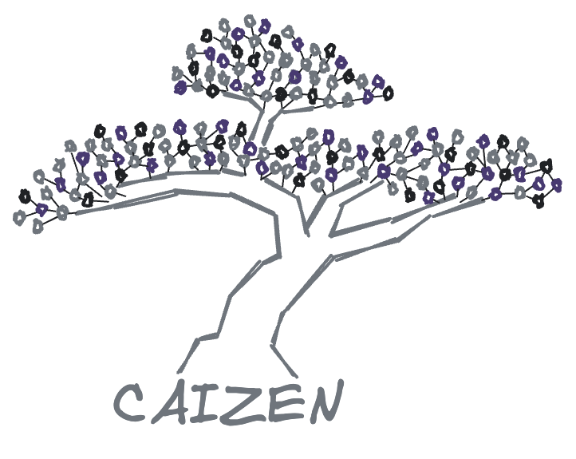

  

  <h3 align="center"><a href="https://caizen.cloud">Caizen</a></h3>

  

    Harness the security superpowers of your cloud asset inventory.
  

## Overview

Caizen is an agent-first attack path analysis system for cloud environments. It gathers inventory and findings into one graph, and agents keep that graph current and use it to choose and apply fixes, as described in the [documentation](https://caizen.cloud/docs/).

## This Repo

| Directory | Contents |
|---|---|
| `app/` | The Caizen service, written in Go. `cmd/` holds the entry point, `internal/` holds the API, data loading, scoring, and agent dispatch packages, and `e2e/` holds the end-to-end tests and their test data. |
| `packs/` | One pack per system, such as `core`, `gcp`, `github`, and `oci`. Each pack holds its SQL rules, feed definitions, and collectors. |
| `terraform/` | Infrastructure code. `platform/` is the platform module, `envs/` holds the deployable environments, and `test-org/` builds the test organization that produces the end-to-end test data. |
| `docs/` | The documentation site, built with Hugo and the Hextra theme and published to [caizen.cloud](https://caizen.cloud). |
| `.github/workflows/` | CI workflows. |

## Background

Caizen began as a fwd:cloudsec 2024 talk. The code from the talk is at the [`fwdcloudsec-2024`](https://github.com/caizencloud/caizen/tree/refs/tags/fwdcloudsec-2024) tag.

- [fwd:cloudsec 2024 talk](https://youtu.be/Bltr5Bn2-70)
- [Talk slides](https://docs.google.com/presentation/d/1TotkfJIeCdl8ftN4i4OlQnZA5Hs4K-03EQoSYbWwdBc)

## License

Licensed under the [Functional Source License, Version 1.1, ALv2 Future License](LICENSE) (FSL-1.1-ALv2). Each release becomes available under the Apache License 2.0 two years after it is published.

Code up to and including the `fwdcloudsec-2024` tag remains under the Apache License 2.0.

## Contact

Brad Geesaman - [LinkedIn](https://linkedin.com/in/bradgeesaman)
