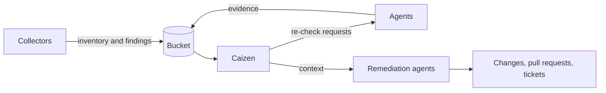

Caizen is an agent-first attack path analysis system for cloud environments. It collects inventory and findings from cloud APIs, container scanners, and source repositories, builds a graph of the ways an attacker could move between resources, and ranks the resulting paths. Agents query the graph for the context they need to choose a fix and then apply it.

Each edge in the graph records where it came from, when it was observed, and how confident Caizen is in it. Confidence decreases as data ages, and Caizen schedules agents to re-check edges before they become unreliable.

## Sections


  
  
  
  
  
  
  

