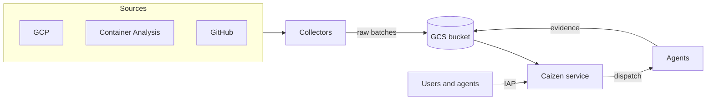

Caizen runs as a single Go service on one VM, with a GCS bucket for storage. Collectors and agents run separately and exchange data with the service through the bucket.

## Service

The service runs as one container on a Container-Optimized OS VM. A single process provides the API, the web UI, data loading, scoring, and agent scheduling. It is the only process that writes to its database. Identity-Aware Proxy handles authentication for users and machine clients.

## Storage

The service stores all durable state in a GCS bucket. Collectors and agents write their output under `raw/`, and nothing modifies it afterward. The service reads `raw/` directly with DuckDB through the `gcs` extension, which authenticates with the VM's service account. It writes no derived data back to the bucket.

The DuckDB file on the VM's disk is the only derived store. It holds the load history, rejected records, resource history, and the graph. A new VM rebuilds the file by replaying `raw/` in batch order, so `raw/` is never deleted. Losing the VM causes downtime but no data loss. A schema change also rebuilds the file, so the service needs no migrations.

## Collectors

Collectors retrieve data from GCP, Container Analysis, and GitHub. Each collector is a Cloud Workflow, started by Cloud Scheduler or run by hand.

Each run writes its files under its own `raw/` prefix and writes a `_SUCCESS` marker when it finishes. The service finds new batches by listing each feed's last 7 days of `ingest_dt=` partitions every hour and skipping batches it has already loaded. A Pub/Sub notification for each new object under `raw/` starts that listing early, so a batch usually loads within seconds. A lost notification only delays loading until the next hourly pass. A feed whose history has not fully loaded, such as a new feed or one on a rebuilt VM, lists its whole history on every pass until it has. After more than 7 days of downtime, an operator runs a reconcile pass that lists each feed's whole history.

## Processing loop

One goroutine owns the database connection that writes. It loads every ready batch and then runs a pass. It also runs a pass on a timer, because confidence decay changes scores when no data arrives. Each pass applies the rules, incorporates new evidence, applies confidence decay, scores paths, ranks fixes, and selects the edges that are due for a re-check. API requests use read-only connections and the results of the last pass.

## Agent dispatch

For each edge that is due for a re-check, the service starts a Cloud Workflow that runs the appropriate agent. The agent writes its results to the bucket, and the service loads them the same way as collector data. Agents read the graph only through the service API and cannot modify it directly. Remediation agents use the same API to get the context for a fix.

## Packs

Packs contain rules, feed definitions, and agent registrations. Each pack covers one system, such as GCP, GitHub, or a container registry, and consists mostly of SQL.

CI publishes each pack to the bucket under a content hash. The service uses one pinned hash at a time, so rolling back a pack is a configuration change.
