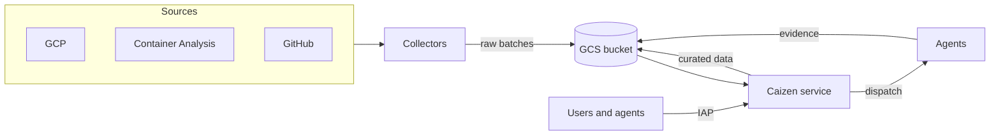

Caizen runs as a single Go service on one VM, with a GCS bucket for storage. Collectors and agents run separately and exchange data with the service through the bucket.

## Service

The service runs as one container on a Container-Optimized OS VM. A single process provides the API, the web UI, data loading, scoring, and agent scheduling. It is the only writer of curated data. Identity-Aware Proxy handles authentication for users and machine clients.

## Storage

The service stores all durable state in a GCS bucket. Collectors and agents write their output under `raw/`, and nothing modifies it afterward. The service derives Parquet files under `curated/` from `raw/` and can rebuild them at any time.

DuckDB on the VM's local disk is a cache. Losing the VM causes downtime but no data loss.

## Collectors

Collectors retrieve data from GCP, Container Analysis, and GitHub. Most collectors are Cloud Run jobs started by Cloud Workflows.

Each run writes its files under its own `raw/` prefix and writes a `_SUCCESS` marker when it finishes. A Pub/Sub notification tells the service that a new batch is ready.

## Processing loop

The service runs a processing loop when a batch arrives and on a timer. Each pass applies the rules, incorporates new evidence, applies confidence decay, scores paths, ranks fixes, and selects the edges that are due for a re-check.

## Agent dispatch

For each edge that is due for a re-check, the service starts a Cloud Workflow that runs the appropriate agent. The agent writes its results to the bucket, and the service loads them the same way as collector data. Agents read the graph only through the service API and cannot modify it directly. Remediation agents use the same API to get the context for a fix.

## Packs

Packs contain rules, feed definitions, and agent registrations. Each pack covers one system, such as GCP, GitHub, or a container registry, and consists mostly of SQL.

CI publishes each pack to the bucket under a content hash. The service uses one pinned hash at a time, so rolling back a pack is a configuration change.
