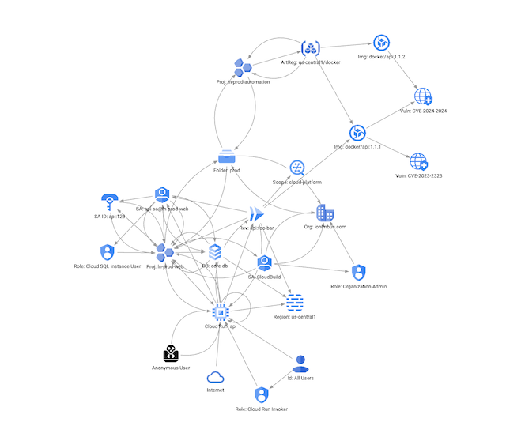
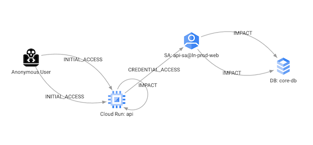
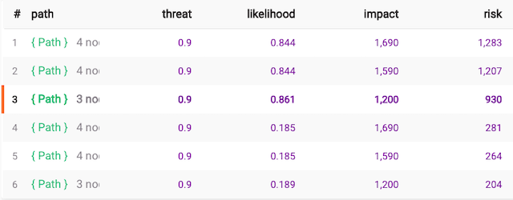

Caizen began as *Pipeline Precognition: Predicting Attack Paths Before Apply*, a talk at fwd:cloudsec 2024.



- [Slides](https://docs.google.com/presentation/d/1TotkfJIeCdl8ftN4i4OlQnZA5Hs4K-03EQoSYbWwdBc)
- [Code from the talk](https://github.com/caizencloud/caizen/tree/refs/tags/fwdcloudsec-2024)
- [Psychiac](https://github.com/caizencloud/psychiac), a companion tool that applied the model to Terraform plans in CI

## The 2024 model

The 2024 implementation loaded resources from GCP Cloud Asset Inventory into Memgraph as a graph.

Rules based on MITRE ATT&CK techniques added attack path edges to the resource graph.

The model scored each path by the value of the resources it reached.

Psychiac applied the same model to Terraform plans in CI to show which attack paths a change would introduce before it was applied.
